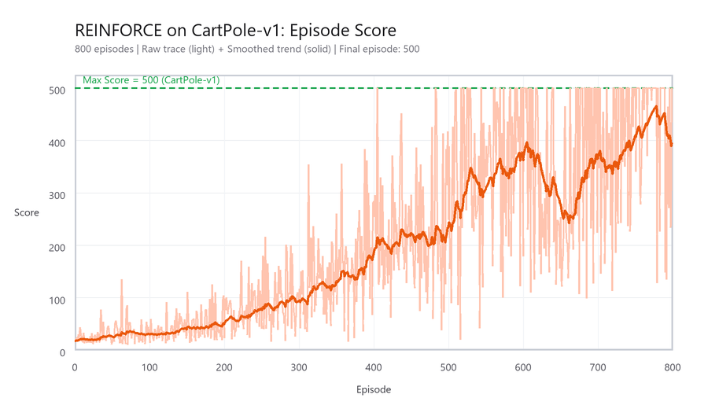
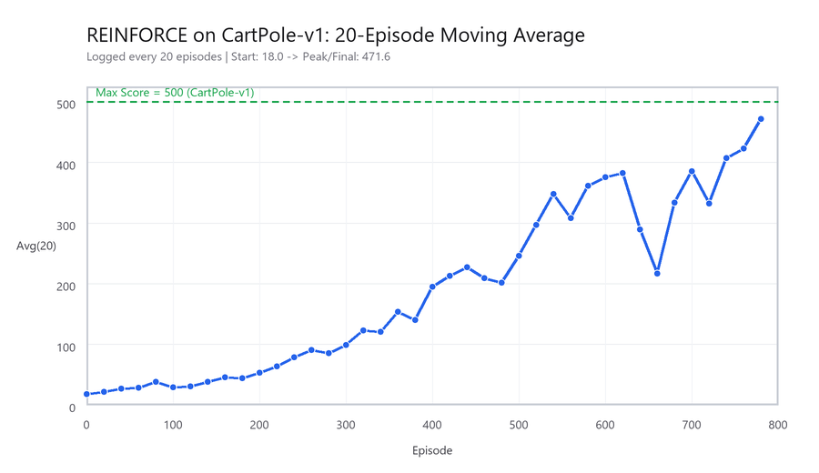

# 02 策略梯度与 REINFORCE 算法（CartPole-v1）

> **实现文件**：[`policy_gradient/reinforce_cartpole.py`](./policy_gradient/reinforce_cartpole.py)  
> **核心目标**：用 PyTorch 神经网络 $\pi_\theta(a\mid s)$ 替代第 1 章的手写控制规则，基于 REINFORCE 蒙特卡洛策略梯度在 `CartPole-v1` 上从十几步训练至 **500 步满分不倒**。

---

## 🧠 核心实现要点

- **策略网络 `PolicyNet`**：`Linear(4, 128) → ReLU → Linear(128, 2) → Softmax(dim=-1)`，直接输出向左/向右动作概率分布。
- **随机策略采样**：使用 `torch.distributions.Categorical(probs)` 按概率采样动作并保留 `log_prob` 计算图。
- **单局蒙特卡洛更新**：整局结束后倒序计算折扣回报 $G_t$（$\gamma = 0.99$）并做单局 Z-score 标准化，计算损失 `loss = -(log_probs_tensor * returns).mean()` 后执行反向传播。
- **确定性验收**：训练结束后切换 `render_mode="human"` 并用 `torch.argmax(probs)` 贪心执行，连续两局跑满 **500 步 `truncated`**。

---

## 📈 训练曲线记录（800 Episodes）

### 1. 每局原始得分与平滑趋势（`episode_score`）

### 2. 每 20 局滑动平均得分（`avg_score_of_20rounds`）
> 从开局 **18.0** 逐步提升至 **471.6**（第 620–660 局附近的明显回落直观体现了纯 REINFORCE 蒙特卡洛估计的高方差特性，也是下一章引入 Actor-Critic 降方差的动机）。

