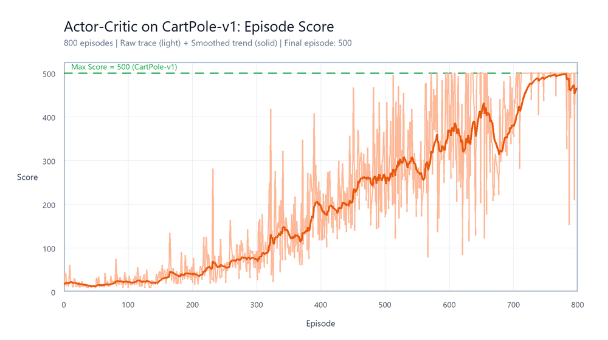
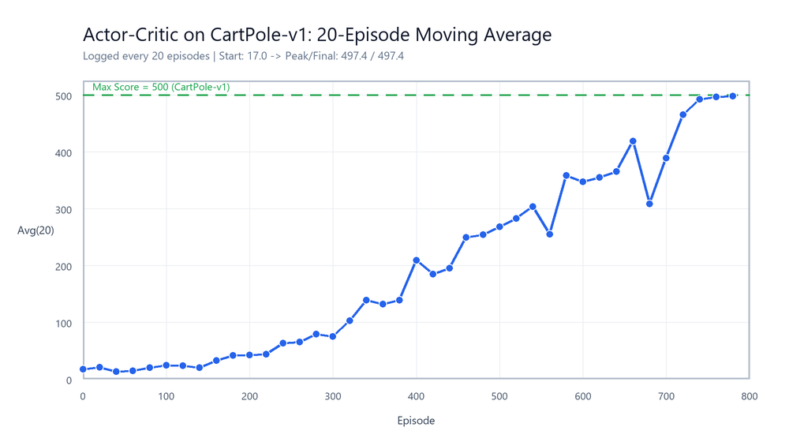
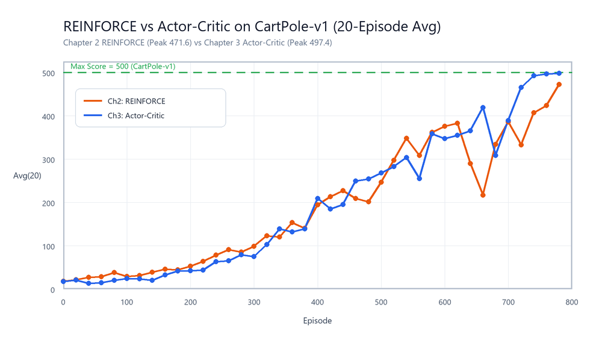

# 03 Actor-Critic 算法（CartPole-v1）

> **工程三层架构**：
> - 模型层：[`network.py`](./network.py)（`PolicyNet` + `ValueNet`）
> - 算法层：[`agent.py`](./agent.py)（`ActorCritic` 双网络 + 双 `Adam` 优化器）
> - 调度层：[`actor_critic_cartpole.py`](./actor_critic_cartpole.py)（环境交互、TensorBoard 记录与 `render_mode="human"` 验收）
>
> **核心目标**：在 `CartPole-v1` 上引入实时估分的评委网络 Critic $V_\phi(s)$，用时序差分误差 $\delta_t$ 替代蒙特卡洛回报 $G_t$，从开局 **17.0** 稳定训练至 **497.35**（近乎满分的 **500** 步不倒）。

---

## 🧠 核心实现要点

- **双网络分工**：
  - **Actor (`PolicyNet`)**：输入 4 维状态，输出动作概率分布并用 `Categorical` 采样。
  - **Critic (`ValueNet`)**：输入 4 维状态，输出单维实数状态价值 $V_\phi(s)$（最后一层不加激活函数）。
- **时序差分目标与误差（1-step TD）**：
  - `td_target = rewards + gamma * critic(next_states) * (1 - dones)`（仅对 `terminated` 清零未来价值，保留 `truncated` 未来估值）。
  - `td_delta = td_target - critic(states)` 作为单步优势估计 $A(s,a)$，并做单局标准化以稳定更新步长。
- **双 `.detach()` 隔离计算图**：
  - Critic 用 `F.mse_loss(critic(states), td_target.detach())` 回归学习打分（半梯度 TD，防止前向状态拉偏目标）。
  - Actor 用 `-(log_probs * adv).mean()`（其中 `adv` 由 `td_delta.detach()` 得到）更新策略，防止梯度倒灌篡改 Critic。

---

## 📈 训练曲线记录（800 Episodes）

### 1. 每局原始得分与平滑趋势（`episode_score`）

### 2. 每 20 局滑动平均得分（`avg_score_of_20rounds`）
> 从开局 **17.0** 逐步爬升至第 740~780 轮的 **492.1 → 496.25 → 497.35**（末尾连续接近 500 步满分）。同时第 660→680 轮曾出现一次回落（`418.25 → 308.0`），直观体现了基础版 Actor-Critic 因缺少策略更新幅度限制而仍有震荡风险——这正是第 4 章引入 **PPO-Clip** 截断保护的直接动机。

### 3. 第 2 章 REINFORCE vs 第 3 章 Actor-Critic 对比

