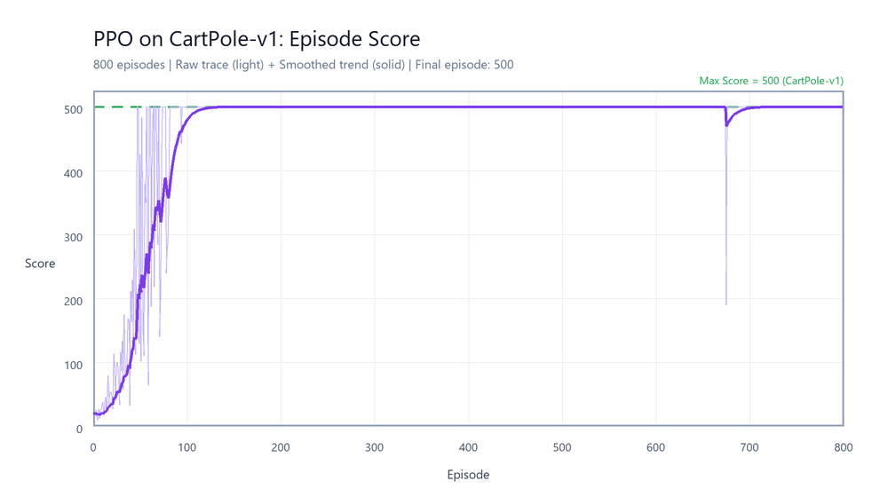
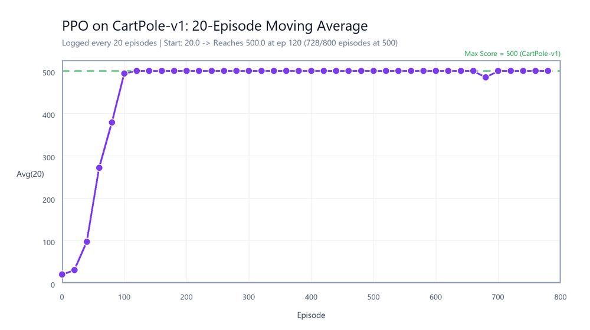
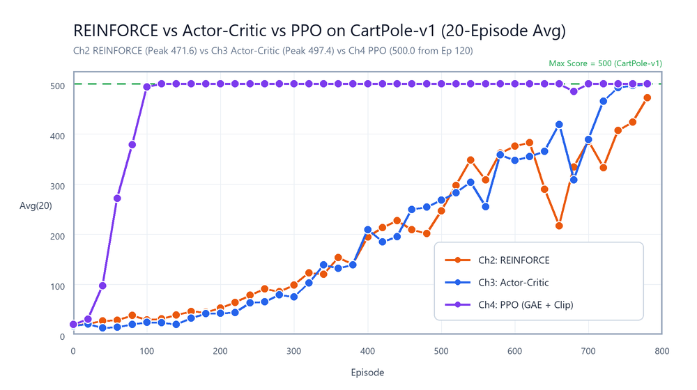
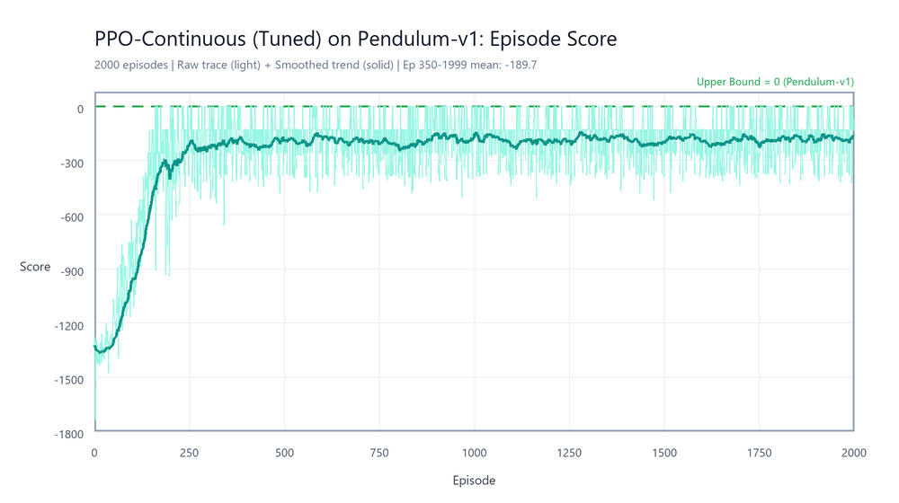
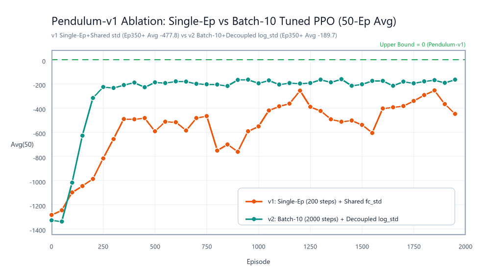

# 04 PPO 算法（离散 CartPole-v1 + 连续 Pendulum-v1 双通关）

> **工程三层架构**：
> - 模型层：[`network.py`](./network.py)（离散 `PolicyNet` + 连续高斯 `PolicyNetContinuous` + 共享 `ValueNet`）
> - 算法层：[`agent.py`](./agent.py)（`PPO` 离散版 + `PPOContinuous` 连续版：GAE、重要性采样、PPO-Clip、`DataLoader` 小批量更新）
> - 调度层：[`ppo_cartpole.py`](./ppo_cartpole.py)（离散控制闭环） / [`ppo_pendulum.py`](./ppo_pendulum.py)（连续力矩控制闭环）
>
> **核心目标**：
> 1. **上半场（离散 `CartPole-v1`）**：引入 **GAE** + **10 轮复用** + **PPO-Clip**，仅用 **120** 轮就拉满 **500.0**，800 局收获 **728** 局满分且彻底杜绝第 3 章的高分塌方。
> 2. **下半场（连续 `Pendulum-v1`）**：将策略网络升级为连续高斯分布 $\mathcal{N}(\mu, \sigma^2)$，并通过 **10 局大 Batch + `DataLoader` 打乱 + 解耦 `log_std` + 梯度裁剪** 完成消融调优，将第 350~1999 局平均分从单局版的 **`-477.80`** 剧烈震荡直接拉平至 **`-189.65`**（评估稳态 `-139.58` / `-253.43`），打通直连 CS123 四足机器狗关节控制的核心范式。

---

## 🧠 核心实现要点

### 1. 离散与连续双版本公共引擎
- **GAE 广义优势估计（$\gamma = 0.98,\ \lambda = 0.95$ / 连续版 $0.9,\ 0.9$）**：
  - 倒序递推 `advantage = delta + gamma * lmbda * (1.0 - done) * advantage`，折中第 2 章 MC 的低偏差与第 3 章 1-step TD 的低方差。
  - 在标准化 `advantage` **之前** 先计算 `returns = advantage + old_values` 作为 Critic 回归目标，保证价值尺度的真实性。
- **冻结旧策略与重要性采样比率（`epochs = 10`）**：
  - 循环外 `with torch.no_grad():` 计算 `old_log_probs` 与 `advantage`；循环内重算 `new_log_probs`，由 `ratio = torch.exp(new_log_probs - old_log_probs)` 计算新旧策略概率比，同一批数据安全复用 10 轮后丢弃（On-policy）。
- **PPO-Clip 截断保护（$\epsilon = 0.2$）**：
  - `surr1 = ratio * advantage`、`surr2 = torch.clamp(ratio, 1 - eps, 1 + eps) * advantage`，取 `-torch.min(surr1, surr2).mean()` 将单步策略变动锁在 $[0.8, 1.2]$ 安全区内。

### 2. 下半场连续动作控制升级（直通四足狗关键点）
- **高斯策略头 `PolicyNetContinuous`**：
  - `mu = action_bound * torch.tanh(self.fc_mu(x))` 将理想力矩均值限位在 $[-2.0, +2.0]\ \text{N}\cdot\text{m}$；
  - 用 `torch.distributions.Normal(mu, std)` 采样并沿动作维 `.sum(dim=-1, keepdim=True)` 聚合对数概率，兼容多关节扩展。
- **奖励缩放**：训练更新内部执行 `rewards = (rewards + 8.0) / 8.0`，将 `[-16.27, 0]` 的原始负分映射至约 `[-1, 1]` 以稳定 Critic 拟合（日志仍记录原始物理得分）。
- **🎯 调优消融（`v1` $\rightarrow$ `v2` 压平震荡的三处核心工程改进）**：
  1. **多局大 Batch + 小土堆 `DataLoader`**：由“每 1 局（200 步）更新 10 轮”升级为“每攒 10 局（2000 步）拼盘，用 `TensorDataset` + `DataLoader(batch_size=128, shuffle=True)` 打乱小批量更新”，同时用 `dones`（`terminated`）算 `td_target`、用 `episode_ends`（`terminated or truncated`）阻断 GAE 跨局倒灌；
  2. **解耦标准差 `log_std`**：将 `fc_std` 从共享特征层 `fc1` 拆出，改用独立可学习参数 `self.log_std = nn.Parameter(torch.zeros(action_dim))` 并经 `clamp(-4.0, 1.0)` + `exp()` 广播对齐，避免更新均值 `mu` 时连带引起探索宽度剧烈抖动；
  3. **温和学习率 + 梯度裁剪**：将学习率由 `actor_lr=1e-4, critic_lr=5e-3` 调整为 `3e-4, 1e-3`，并在反向传播后加入 `clip_grad_norm_(..., 0.5)`。

---

## 📈 上半场训练曲线：离散 `CartPole-v1`（800 Episodes）

### 1. 每局原始得分与平滑趋势（`episode_score`）
> 第 **47** 局首次拿到 **500** 满分；第 **82** 局起 718 局中共收获 **716** 次 500 满分（仅第 94 局 `443.0` 与第 675 局 `189.0` 短暂偏离并立刻恢复）。

### 2. 每 20 局滑动平均得分（`avg_score_of_20rounds`）
> 从 `20.0 (ep 0) → 30.1 (ep 20) → 96.55 (ep 40) → 271.05 (ep 60) → 377.9 (ep 80) → 493.35 (ep 100) → 500.0 (ep 120)`，第 120 轮起稳稳锁死在 **500.0**（仅第 680 轮短暂记为 `484.45` 后即刻回满）。

### 3. 三章主线终极对比：REINFORCE vs Actor-Critic vs PPO

| 章节与算法 | 首次触达 500 轮次 | 20 局均分峰值 | 800 局内满分（500）总次数 | 典型特征 |
| :--- | :---: | :---: | :---: | :--- |
| 第 2 章 REINFORCE（MC） | 第 405 局 | 471.6 | 92 / 800 | 无偏但高方差，后期仍大幅震荡 |
| 第 3 章 Actor-Critic（1-step TD） | 第 572 局 | 497.35 | 109 / 800 | 起步稳但无更新保护（曾出现 `418.25 → 308.0` 塌方） |
| **第 4 章 PPO（GAE + Clip）** | **第 47 局** | **500.0** | **728 / 800** | **120 轮即贴顶，高分锁死不塌方** |

---

## 📈 下半场训练曲线：连续 `Pendulum-v1`（2000 Episodes）

### 1. 调优后（`v2`）每局得分与平滑趋势（`episode_score`）
> 从开局 `-1329.06` 快速甩摆爬升，第 **250** 轮均值已达 **`-227.46`**；第 **350~1999** 轮全程平均得分 **`-189.65`**，确定性验收两局分别为 **`-139.58`** 和 **`-253.43`**（对应从上方/正下方随机起始角甩起立稳的理论近最优区间）。

### 2. 消融对比：`v1`（单局 200 步 + 共享 `fc_std`）vs `v2`（10 局 Batch + `DataLoader` + 解耦 `log_std`）

| 版本与工程配置 | 收敛至 `-230` 以内轮次 | 50 局滑动均分峰值 | 第 350~1999 局平均分 | 末尾 50 局均分（ep 1950） | 稳定性表现 |
| :--- | :---: | :---: | :---: | :---: | :--- |
| **`v1`（单局更新 + 共享 `fc_std`）** | 未稳定（1200 轮瞬时 `-256.95`） | `-254.18`（ep 1850） | `-477.80` | `-448.35` | 在 `-254 ~ -763` 间剧烈拉锯震荡 |
| **`v2`（10 局 Batch + 解耦 `log_std` + 梯度裁剪）** | **第 250 轮（`-227.46`）** | **`-162.40`（ep 1400）** | **`-189.65`** | **`-166.77`** | **第 250 轮后全程稳居 `-162 ~ -234`，零塌方** |

