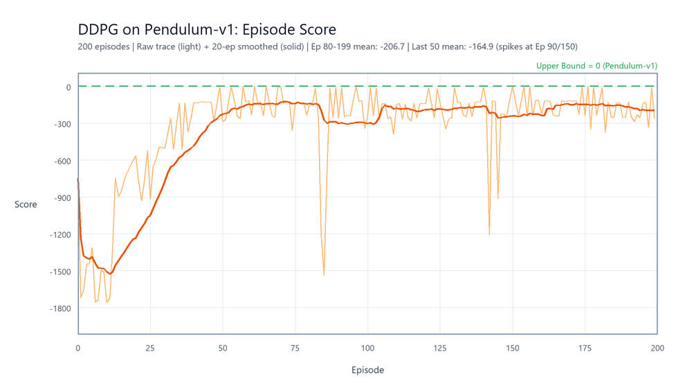
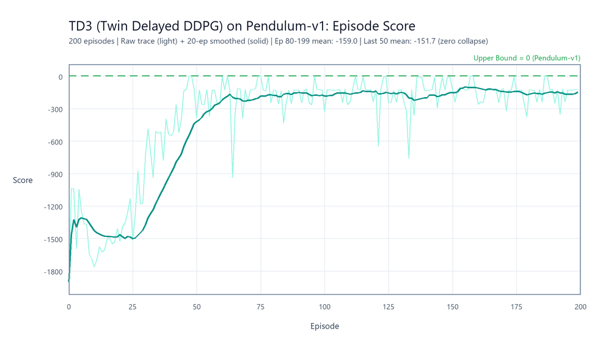
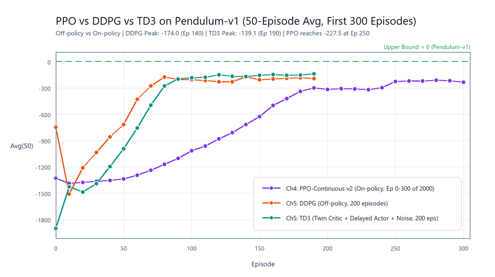

# 05 Off-policy 支线：DDPG & TD3 算法（Pendulum-v1 样本效率对比 & 衔接 Reacher 机械臂）

> **工程三层架构**：
> - 模型层：[`network.py`](./network.py)（确定性策略 `PolicyNet` + 拼接 `(state, action)` 动作价值网络 `QValueNet`）
> - 算法层：[`agent.py`](./agent.py)（`ReplayBuffer` 经验回放池 + `DDPG` + `TD3` 升级版）
> - 调度层：[`ddpg_pendulum.py`](./ddpg_pendulum.py) / [`td3_pendulum.py`](./td3_pendulum.py)（每步交互入池、满 `minimal_size` 后每步随机采样更新 + `render_mode="human"` 验收）
>
> **核心目标**：在连续控制 `Pendulum-v1` 上亲手打通 **Off-policy（经验回放 + 确定性策略 + 借道求导 + 软更新）** 工程范式，并用 **仅 200 局（4 万步）** 验证相比第 4 章 **On-policy PPO（2000 局）** 的样本效率飞跃，同时通过 **TD3 三大工程补丁** 消除单 Critic 高估引起的稳态抽风波动（50 局滑动均分推至 **`-139.07`**）。

---

## 🧠 核心实现要点

### 1. 从第 4 章 PPO 到 DDPG 的范式切换
- **确定性策略 `PolicyNet`**：移除高斯分布的 `log_std`，直接输出限位力矩 `mu = action_bound * torch.tanh(self.fc2(x))`；交互探索阶段在输出动作上叠加高斯噪声并 `np.clip` 限幅。
- **动作价值网络 `QValueNet(s, a)`**：第一层输入维度扩为 `state_dim + action_dim`，在 `forward` 中沿最后一维拼接 `torch.cat([x, a], dim=-1)`，将评价体系从状态平均价值 $V(s)$ 升级为可对动作求偏导的 $Q_\phi(s, a)$。
- **经验回放池 `ReplayBuffer`**：基于 `collections.deque(maxlen=10000)` 存储 `(s, a, r, s', done)` 客观物理转移样本；当样本量超过 `minimal_size = 1000` 后，每走 1 步随机采样 `batch_size = 64` 更新网络，彻底摆脱 On-policy 用完即弃、依赖 `old_log_probs` 与 `PPO-Clip` 的限制。
- **借道求导与双 Target 软更新**：
  - Actor 损失 `actor_loss = -self.critic(states, self.actor(states)).mean()`，令梯度穿过 Critic 传回 Actor（仅调用 `actor_optimizer.step()`，不改动 Critic 参数）；
  - 使用 `copy.deepcopy` 维护 `target_actor` 与 `target_critic`，每步按 $\tau = 0.005$ 执行原地软更新 `target = (1 - tau) * target + tau * net`，防止自举目标剧烈漂移。

### 2. 从 DDPG 升级到 TD3（Twin Delayed DDPG）的 3 处补丁
在复用同一套 [`network.py`](./network.py) 的前提下，[`agent.py`](./agent.py) 中的 `TD3` 类补充了 3 项直接面向连续控制/机械臂任务的稳定性改造：
1. **双 Critic 取最小值（Clipped Double Q-Learning）**：并行训练 `critic1` 与 `critic2`（及对应 Target 网络），计算 `q_targets` 时取 `torch.min(target_q1, target_q2)` 抑制 Q 值高估。
2. **目标动作平滑（Target Policy Smoothing）**：在 `target_actor(next_states)` 输出上添加截断高斯噪声（`policy_noise=0.2`、`noise_clip=0.5`）并裁剪至动作合法区间，避免评委在单点动作上过拟合尖峰。
3. **延迟更新策略（Delayed Policy Updates）**：Critic 每次采样都更新；Actor 更新（借道 `critic1`）与 3 个目标网络的 `soft_update` 每隔 `policy_freq = 2` 步执行一次。

---

## 📈 训练曲线与三算法对比（`Pendulum-v1`）

### 1. DDPG 200 局每局得分与平滑趋势（`ddpg_pendulum-v1`）
> 上手极快：第 **50** 局最近 10 局均分已达 **`-133.75`**，第 **80** 局 50 局滑动均分达到 **`-177.22`**（第 80~199 局均值 **`-206.65`**，评估两局 **`-123.54` / `-233.99`**）。但受单 Q 网络高估影响，稳态后在 **第 90 局**（10 局均分回落 `-426.78`）和 **第 150 局**（10 局均分回落 `-333.00`，期间单局最低落至 `-1539.33`）仍出现过局部抽风掉分。

### 2. TD3 200 局每局得分与平滑趋势（`td3_pendulum-v1`）
> 打上 TD3 补丁后第 **80** 局起彻底锁死高分稳态：第 80~199 局全程平均分提升至 **`-159.02`**，末尾 50 局均分达 **`-151.73`**（第 **150** 局最近 10 局均分冲至 **`-99.01`**，第 **190** 局 50 局滑动均分创下 **`-139.07`** 峰值），全程再无 `-1000` 级别塌方，确定性评估两局分别为 **`-264.38`** 与 **`-3.82`**。

### 3. 第 4 章 PPO vs 第 5 章 DDPG / TD3 样本效率横向对比（前 300 局 `Avg(50)`）

| 章节与算法 | 类型 | 总训练局数 | 进入 `-230` 以内轮次 | 50 局滑动均分峰值 | Ep 80~199 均分 | 稳态表现与典型特征 |
| :--- | :---: | :---: | :---: | :---: | :---: | :--- |
| [`04_ppo`](./../04_ppo/) **PPO-Continuous (`v2`)** | On-policy | 2000 局 | 第 **250** 局（`-227.46`） | `-162.40`（ep 1400） | `-553.35`（前 200 局均值 `-831.80`） | 稳态极强但前 200 局爬坡慢，需 10 倍环境交互量 |
| [`05_ddpg_branch`](./ddpg_pendulum.py) **DDPG** | Off-policy | **200 局** | **第 80 局**（`-177.22`） | `-174.05`（ep 140） | `-206.65`（末尾 50 局 `-164.95`） | 样本效率起飞，但单 Critic 高估导致偶发回落波动 |
| [`05_ddpg_branch`](./td3_pendulum.py) **TD3** | Off-policy | **200 局** | **第 90 局**（`-199.55`） | **`-139.07`（ep 190）** | **`-159.02`（末尾 50 局 `-151.73`）** | **兼具 Off-policy 高样本效率与零塌方高上限** |

---

## 🦾 衔接独立 Reacher 机械臂项目清单

直接复用本目录三层工程骨架迁往多自由度机械臂（如 `Reacher-v4/v5`、`FetchReach`）时，仅需按以下 4 步调整外围配置：
1. **自动读取状态/动作维度与力矩限位**：用 `env.observation_space.shape[0]`、`env.action_space.shape[0]` 与 `env.action_space.high[0]` 替代固定值（或多轴非对称限位直接套用 `gym.wrappers.RescaleAction(..., -1.0, 1.0)`）。
2. **扩容容量与网络宽度**：将 `hidden_dim` 提至 `256`、`ReplayBuffer(capacity=100000+)`、`batch_size=128/256`。
3. **初期随机探索热身 + 放大探索噪声**：前 `2000~5000` 步用 `env.action_space.sample()` 充实回放池，正式训练将探索 `sigma` 提至 `0.1 * action_bound`。
4. **稀疏奖励扩展**：若迁移至稀疏奖励抓取任务，可在 `ReplayBuffer` 中叠加 **HER（Hindsight Experience Replay）**，复用本章节的 Off-policy 数据流即可直接起飞。
